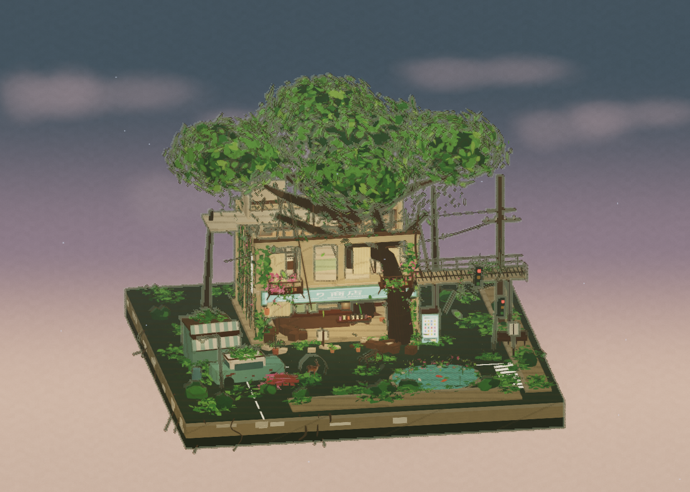
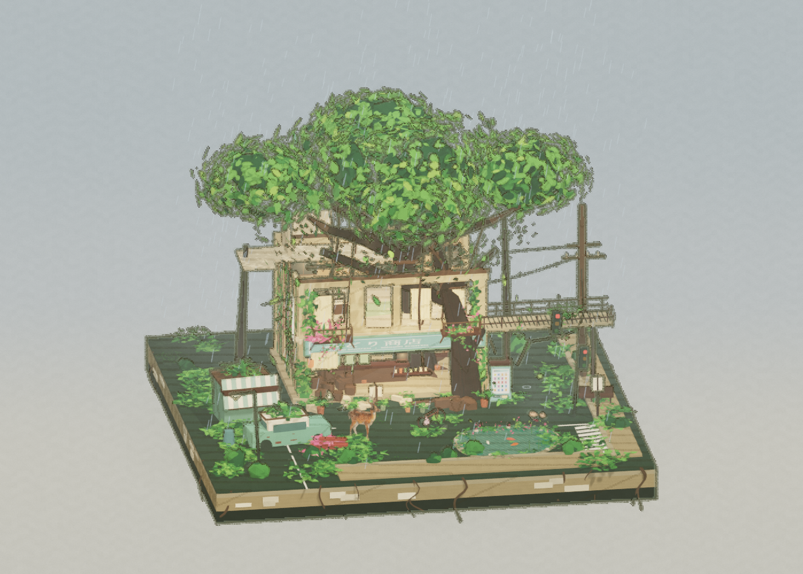
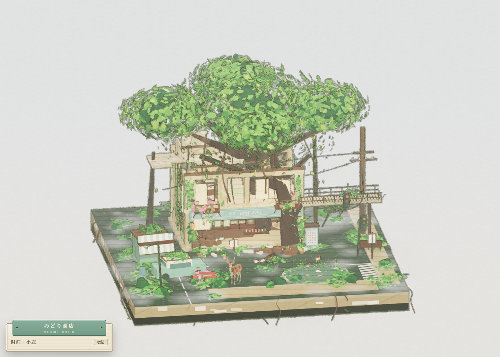

# みどり商店 · 被自然收回的街角

一个可离线运行的单文件 3D 微缩场景：废墟街角里的杂货店、图生 3D 小鹿、时间与天气系统。



## 特点

- 单文件 HTML（约 5MB）：three.js 全内联，小鹿 GLB（含 Walk / Run / Idle 骨骼动画）base64 内嵌，无外部依赖，双击即可打开。
- 时间系统：06:00–18:30 自动流转（现实 1 秒 = 场景 2 分钟），天空、雾、阳光、影子随时间变化，入暮后店铺灯、路灯、信号灯逐渐点亮。
- 天气：雨势与雪势独立调节。雨滴落地生成涟漪、雾气缓慢飘散；雪花分大小两层飘落，地面积雪缓慢累积，开雨或降雪势时慢慢融化。
- 小鹿：可调大小、走路速度、逃跑速度；会游荡、吃草、警觉、受惊逃跑；全图漫游带实体碰撞，不会穿模；点击小鹿会沿红/蓝/黄三种随机路线逃跑。
- 氛围细节：树叶风摆（逐叶空间相位）、飘落叶片、池水、鱼、蝴蝶、蜻蜓、猫、旧电线与手绘描边。



## 操作

- 鼠标滚轮：缩放模型视角
- 拖拽：旋转 / 平移视角
- 点击小鹿：受惊逃跑
- 左下角控制台：拖动滑杆调节时间、雨势、雪势、小鹿大小、走路速度、逃跑速度

## 截图

| 雨 | 雪 |
| --- | --- |
|  |  |

## 技术说明

- three.js r147（内联）
- WebGL2 渲染，后处理：手绘描边 + 纸张颗粒 + 曝光
- 自研 GLB 解析器与骨骼动画播放器
- 场景碰撞体自动生成（建筑、车、树、池塘、路灯、长椅等）

## 运行

直接双击 `index.html`，或使用本地静态服务器：

```bash
python -m http.server 8000
```

然后打开 <http://localhost:8000>。

## 说明

本项目为个人创作练习，小鹿模型与场景风格来自作者提供的参考素材。

